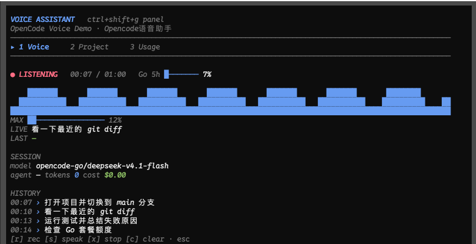

# OpenCode 语音助手

给 OpenCode V2 TUI 增加系统语音、实时波形和一个综合控制面板。它是第三方 TUI 插件，不修改 OpenCode 本身，所以 OpenCode 原有的会话、模型、工具、权限等功能全部保留。

> 仅支持 macOS（Apple Speech.framework 需要 App bundle）。需要 OpenCode V2、Xcode Command Line Tools（`swiftc`）。
>
> 非 OpenCode 官方项目，与 OpenCode / Anomaly 无隶属关系。



> 面板预览使用 demo 数据，实际界面会跟随 OpenCode 主题。

## 功能

- **长按说话（可选）**：`Option+V` 开始录音，松开停止。
- **快捷键开关**：`Ctrl+Shift+V` 按一次开始，再按一次停止，不需要长按；`F9` 备用。
- **点击说话**：点击底部 `[ ○ 语音 ]` 切换录音，不需要长按。
- **识别结果进主输入框**：可继续编辑、Backspace 删除，按 Enter 发送。
- **Go 5h 常驻**：footer 显示 5 小时窗口进度条 `Go 5h ░░░ 2%`，点它或 `/voice-usage` 打开 Usage 页签。
- **实时波形**：录音时在输入框上方显示 RMS 波形、已用时间和部分识别文本。
- **控制面板**：`Ctrl+Shift+G` 打开，包含：
  - `1 Voice`：状态、波形、识别进度、历史、朗读
  - `2 Project`：当前项目、分支、最近项目；Enter 打开项目最近会话（没有则新建）
  - `3 Usage`：OpenCode Go rolling / weekly / monthly 额度、重置时间、budgets
- **朗读**：`/voice-speak` 朗读上一条助手回复，`say` + `Tingting`。
- **中英混用**：默认 `zh-CN`，通过 `contextualStrings` 注入 OpenCode / git / diff / 项目名 / 分支等词。

## 安装

```bash
git clone <your-repo-url> opencode-voice-assistant
cd opencode-voice-assistant
npm install
npm run build:voice
```

把插件路径加入 `~/.config/opencode/cli.json`：

```json
{
  "plugins": [
    "<path-to-repo>"
  ]
}
```

已经存在 `plugins` 数组时，把路径追加进去即可。`<path-to-repo>` 要替换成克隆后的绝对路径（或 `file://...`）。保存后 OpenCode 会自动重载配置；如果 TUI 没有变化，执行 `/reload` 或重新打开。

## 首次使用

`native/voice.swift` 会构建成 `bin/OpenCodeVoice.app`。macOS 的 Speech.framework 不允许裸命令行二进制调用语音识别（会触发 TCC 崩溃），所以语音 helper 必须作为 App bundle 启动；插件通过 localhost TCP socket 和它通信。

第一次录音时 macOS 会弹出 **OpenCode Voice** 的权限请求：

1. **语音识别**：系统设置 → 隐私与安全性 → 语音识别
2. **麦克风**：系统设置 → 隐私与安全性 → 麦克风

授权给 **OpenCode Voice**，不是终端。默认使用 Apple 的 on-device 识别，音频不上传。若某种语言没有本地模型，可在插件 `options` 中设置 `"allowNetwork": true` 使用 Apple 的服务器识别。

## 使用

| 操作 | 说明 |
| --- | --- |
| 按住 `Option+V` | 可选的长按模式；松开识别 |
| `Ctrl+Shift+V` | 按一次开始录音，再按一次停止（推荐，不依赖 Option） |
| `F9` | 备用开始/停止键 |
| 点击底部 `[ ○ 语音 ]` | 点击切换录音，不需要长按 |
| 识别完成后 | 文本已填入输入框，编辑/删除后 Enter 发送 |
| `Ctrl+Shift+G` | 打开/关闭控制面板 |
| 点击 footer `Go 5h` | 直接打开 Usage 页签 |
| `/voice` | 开始/停止录音 |
| `/voice-toggle` | 与 `Ctrl+Shift+V` 相同 |
| `/voice-usage` | 直接打开 Go 用量页签 |
| `/voice-panel` | 打开控制面板（没有会话时会新建） |
| `/voice-speak` | 朗读上一条回复 |
| 面板 `1-3` | 切换 Voice / Project / Usage |
| 面板 `j/k` | 选择项目 |
| 面板 `Enter` | 打开项目 / 打开用量页 |
| 面板 `p` | 内置最近项目/会话菜单 |
| 面板 `u` | 浏览器打开 Go 用量页面 |
| 面板 `r/s/x/c` | 录音 / 朗读 / 停止朗读 / 清空历史 |
| 面板 `Esc` / `q` | 关闭面板 |

## Options

在 `cli.json` 中使用对象形式：

```json
{
  "plugins": [
    {
      "package": "<path-to-repo>",
      "options": {
        "locale": "zh-CN",
        "maxSeconds": 60,
        "onDevice": true,
        "voice": "Tingting",
        "rate": 190,
        "autoSpeak": false,
        "keybind": "alt+v",
        "toggleKeybind": "ctrl+shift+v",
        "panelKeybind": "ctrl+shift+g"
      }
    }
  ]
}
```

| 选项 | 默认 | 说明 |
| --- | --- | --- |
| `keybind` | `alt+v` | 可选长按录音键 |
| `toggleKeybind` | `ctrl+shift+v` | 按一次开始/再按一次停止 |
| `panelKeybind` | `ctrl+shift+g` | 控制面板键 |
| `locale` | `zh-CN` | 识别语言；可切 `en-US` |
| `maxSeconds` | `60` | 单次录音上限 |
| `onDevice` | `true` | 只用本地识别 |
| `allowNetwork` | `false` | 本地模型不可用时允许 Apple 服务器识别 |
| `voice` | `Tingting` | `say` 的发音人 |
| `rate` | `190` | 朗读速度 |
| `autoSpeak` | `false` | 助手完成后自动朗读 |
| `contextual` | 内置词表 | 额外识别提示词 |
| `helperPath` | 自动 | `OpenCodeVoice.app` 路径 |
| `debug` | `false` | 在 footer 显示初始化阶段，并自动打开面板 |

## 实现说明

- 插件是 **TUI-only**，通过 `~/.config/opencode/cli.json` 加载，不需要 server part。
- `native/voice.swift` 构建成 `bin/OpenCodeVoice.app`：`AVAudioEngine` 采集 + `SFSpeechRecognizer` 识别，结果通过 localhost TCP socket 以 JSONL 发给插件（`hello/ready/level/partial/final/error`），socket 接收 `stop/cancel`。App bundle 的 Info.plist 带麦克风和语音识别用途说明，TCC 才会放行。
- 识别结果写入主输入框使用系统剪贴板 + OpenCode 内置 `prompt.paste` 命令。它会用识别文本覆盖当前剪贴板；如果输入框没有出现文字，按 `Ctrl+V` 即可。
- 快捷键优先走 OpenCode 的 keymap，同时用 `renderer.keyInput` 做一份 press 兜底；两边都触发时用 180ms 防抖避免重复切换。`F9`/`F10` 是备用键。若 macOS Terminal 不把 Option 当 Meta，`Option+V`/`Option+G` 会失效，改用 `Ctrl+Shift+V`/`Ctrl+Shift+G` 或 F9/F10。
- Go 5h 进度条常驻在 footer；语音按钮也在 footer 右侧。插件 API 没有“输入框右侧”的 slot，所以无法真正放进输入框内部；footer 是官方支持的最接近位置。

## 开发调试

```bash
OPENCODE_VOICE_DEBUG=1 opencode --standalone
OPENCODE_VOICE_DEBUG_TAB=usage opencode --standalone
OPENCODE_VOICE_DEBUG_PASTE="hello OpenCode 语音" opencode --standalone
OPENCODE_VOICE_DEBUG_RECORD=1 OPENCODE_VOICE_DEBUG_HELPER=selftest opencode --standalone
```

- `OPENCODE_VOICE_DEBUG=1`：footer 显示初始化阶段，2.5 秒后自动创建会话并打开面板。
- `OPENCODE_VOICE_DEBUG_TAB=usage|project`：直接打开对应页签。
- `OPENCODE_VOICE_DEBUG_PASTE=...`：跳过麦克风，直接测试“填入输入框”链路。
- `OPENCODE_VOICE_DEBUG_HELPER=selftest`：让 App 发假音频事件，验证 app 启动、socket、final 和粘贴全链路，不触发 TCC。
- `OPENCODE_VOICE_DEBUG_RECORD=1`：启动 3 秒后自动录音；和 `selftest` 一起用可做无人值守回归。
- `OPENCODE_VOICE_DEBUG_KEYS=1`：每次按键弹出 `name/ctrl/shift/alt`，用来确认终端是否把快捷键送进 TUI。

## 已知限制

- `SFSpeechRecognizer` 在 macOS 26+ 已标记弃用，当前 macOS 27 仍可用；未来失效时迁移到 `SpeechAnalyzer`。
- 中英混用靠 `zh-CN` + 英文提示词，代码标识符和生僻词仍可能识别错；可在 `contextual` 里补充项目词汇。
- TTS 的进度无法从 `say` 获取，只显示“朗读中”和已用时间；不造假进度条。
- 面板的 Go 额度接口是实验性接口 `/api/experimental/usage/limits`，接口变化时只影响 Usage 页签，不影响语音。

## 隐私

- 默认 `onDevice: true`，语音识别在 Apple Speech 的本地模型上完成，音频不上传。
- `allowNetwork: true` 时才会使用 Apple 的服务器识别。
- 识别文本会写入系统剪贴板以调用 OpenCode 的 `prompt.paste`；其他 App 可能读取剪贴板，发送后也可能留在剪贴板里。
- 不包含遥测。Go 额度通过本机 OpenCode 服务读取，不额外保存凭据。
- 语音历史保存在 OpenCode 插件的本地 storage 里，面板 `c` 可清空。

## 兼容性

- OpenCode V2（开发时使用 2.2.5）。
- 使用实验性接口 `client.experimental.usage.limits`；该接口变化时只影响 Usage 页签。
- 使用 OpenCode 的 TUI keymap 和 `renderer.keyInput`；OpenCode 大版本升级后可能需要适配。
- 仅 macOS；`bin/OpenCodeVoice.app` 是 ad-hoc 签名的本地构建产物，仓库不提交二进制。

## 设计

面板遵循 [tui-design](https://github.com/pageton/tui-design-skill)（MIT）的 dashboard 设计原则：单一强调色、语义状态色、留白优先、少用边框、键盘优先。

## License

MIT
